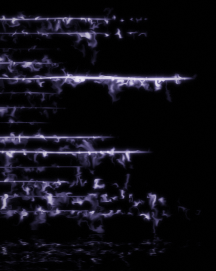

# audio_streaks (TouchDesigner)

Linhas de luz horizontais que reagem à música, com fiapos que se soltam das
linhas, glow branco → roxo dessaturado, fundo preto e reflexo na água.



## Montar no TD

No Textport (Alt+T):

```python
ROOT = r'C:/caminho/para/olucasmicael/touchdesigner/audio_streaks'
exec(open(ROOT + '/build_audio_streaks.py', encoding='utf-8').read())
```

Isso cria `/project1/audio_streaks` (rodar de novo recria do zero). Os
parâmetros ficam na página **Streaks** do COMP. A fonte padrão é o Audio
Device In; para usar um arquivo, troque **Fonte de audio** para *Arquivo* e
escolha o arquivo.

Os Text DATs dos shaders ficam sincronizados com `shaders/*.glsl`: editou o
arquivo, o TD recarrega.

## Rede

```
audio_device ┐
audio_file  ─┴ switch → audio spectrum → CHOP to TOP
  → spectrum_smooth (feedback: ataque rápido, release lento)
  → lines   (uma linha por banda, grave embaixo; o X percorre as
             sub-frequências da banda, por isso a linha se quebra)
  → trails  (feedback com curl noise: só faíscas da linha soltam fiapos)
  → bloom pequeno + bloom grande
  → grade   (núcleo branco-lilás, glow roxo, saturação, reflexo) → out1
```

## Ajustes que mais mudam o resultado

| Parâmetro | Efeito |
|---|---|
| Ganho do audio | quanto a música estica/acende as linhas. Ajuste primeiro, depende do nível de entrada |
| Duração dos fiapos / Torção / Faíscas | densidade e formato das "penas" |
| Corte do rastro | sobe se aparecer névoa entre as linhas |
| Cor do nucleo / Cor do glow / Saturacao | paleta; padrão é branco-lilás com roxo dessaturado |
| Linha d'agua | altura do reflexo (0 desliga) |
| Espectro ja e log | ligue se o Audio Spectrum CHOP já estiver com o eixo de frequência em log |

## Prévia no navegador

`preview/index.html` roda os mesmos `.glsl` em WebGL, com espectro sintético,
arquivo de áudio ou microfone. Precisa ser servido por HTTP:

```
npx http-server touchdesigner/audio_streaks -p 8765
# abrir http://localhost:8765/preview/
```
